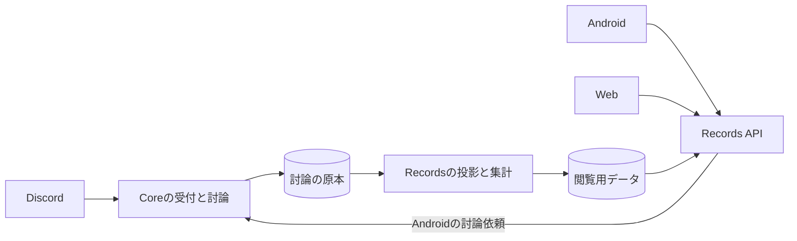

# 要求仕様書・基本設計書

[文書索引へ戻る](00_シッテムの箱_ドキュメント索引.md)

## 目的と対象

少人数の非公開Discordサーバーで、友人同士が3人のAI参加者に相談し、意見の違いや討論の結論を楽しむ。記録や思い出はWebとAndroidから振り返る。本番環境は1つとし、利用と運用の規模を対象サーバーに合わせる。

## 利用者に提供する機能

| 機能 | 利用体験 | 詳細設計 |
| --- | --- | --- |
| 討論と更問 | Discordの `/shittim` またはAndroidから議題を送り、必要に応じて画像を添付する。完了した討論から追加質問を始められる。 | [Discord受付・投稿](11_Discord詳細設計.md)・[Android受付](29_Androidアプリ設計.md#androidからの議論開始) |
| 議論の記録 | 議題、初回意見、最終案、投票理由、結論、親愛度の変化を閲覧する。Androidでは有効なオフライン閲覧認可で端末に同期済みの記録を読める。 | [Records](24_シッテムの箱%20議事録設計.md)・[Android](29_Androidアプリ設計.md) |
| いろいろな記録 | 勝利・依頼・親愛度のランキングと概算費用を確認する。 | [Records](24_シッテムの箱%20議事録設計.md)・[親愛度](26_親愛度・ランキング設計.md) |
| メモリアルロビー | 親愛度の到達で本人に解放し、写真・アバターから記念画像と文章を作る。親愛度をリセットして次の達成を目指す場合も、生成済みの思い出は残る。 | [メモリアルロビー](27_メモリアルロビー設計.md) |
| モモトーク | 3人の週次の雑談と、条件を満たしたときの自撮りを閲覧する。 | [モモトーク](28_モモトーク設計.md) |
| 生徒ガチャ・生徒図鑑 | Discordの生徒募集でカードを獲得し、サーバーで集めたカードや重複分を図鑑で閲覧する。 | [Discordの生徒ガチャ](11_Discord詳細設計.md)・[Recordsの図鑑](24_シッテムの箱%20議事録設計.md) |
| 状態確認とプロンプト管理 | 稼働状況・警告・現行プロンプト・変更履歴を閲覧する。管理者はプロンプトを編集・反映・復元できる。 | [状態確認・プロンプト管理](25_サービス状態確認・プロンプト管理設計.md) |

## 討論の進め方

1. Coreが議題を永続化して受け付け、必要に応じて討論ランタイムを起動する。Discordには受付と進行状況を表示する。
2. 司会1体と参加者3体を1プロセスで動かす。質問ごとの親愛度評価は3人分が揃った場合にまとめて反映し、全員に共通の参考情報を用意する。
3. 参加者は初回意見と最終案を出し、匿名化された他者の案に投票する。全票の確定後にPythonが得票と採点から勝者を決め、勝者が結論を発表する。
4. 保存済みの完了記録をRecordsが非同期に取り込み、記録閲覧や集計に反映する。

親愛度は発言の口調や熱意に反映する。投票・勝者決定・参考情報の規則は共通とし、他者の人格本文は参加者へ渡さない。進行と再開は[アプリケーション設計](10_アプリケーション・Python詳細設計.md)、AIの入出力契約は[OpenAI・プロンプト設計](12_OpenAI・プロンプト詳細設計.md)、親愛度の値と更新条件は[親愛度設計](26_親愛度・ランキング設計.md)で定義する。

## 利用権限

| 対象 | 必要な権限 |
| --- | --- |
| 議論の記録・ランキング・費用・モモトーク・生徒図鑑 | 対象Discordサーバーの認証済み利用者 |
| サービス状態・プロンプトと履歴の参照 | 対象Discordサーバーの認証済み利用者 |
| プロンプトの反映・復元 | 管理者 |
| メモリアルの生成・閲覧・リセット | 対象アカウント本人 |

認可は各APIで検証する。サービス状態画面は閲覧・更新用で、タスクやキューの管理操作は運用手順で扱う。プライバシー情報とデータ削除の申請案内は公開する。[セキュリティ・プライバシー設計](16_セキュリティ・プライバシー詳細設計.md)

## 全体構成と処理の継続性

- 討論ランタイムはARM64 On-Demand Fargateで、平常時は0タスク、処理が必要なときだけ最大1タスクを動かす。起動・停止やAWSリソースの責務は[基盤設計](14_AWS・CDK詳細設計.md)に定める。
- 受付・進捗・生成結果・投稿待ちデータを保存し、中断後に再開できるようにする。期限切れの処理権による書き込みを拒否する。[データ整合性設計](13_DynamoDB・データ整合性詳細設計.md)
- 本文は処理と閲覧に必要な範囲で保存する。ログには利用者の質問・回答、認証情報、非公開の人格本文を出さない。保存と削除の条件はデータ種別ごとに[セキュリティ設計](16_セキュリティ・プライバシー詳細設計.md)で定義する。
- 変更範囲に応じて[試験方針](18_試験・品質保証設計.md)と[配信設計](15_GitHub・CI-CD詳細設計.md)に従う。配信と実利用の確認結果は[検証記録](20_実装・試験・検証記録.md)で確認する。
