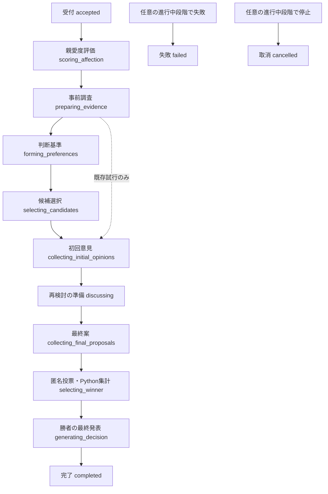

---
aliases:
  - The Shittim Chest アプリケーション詳細設計
tags: [project, shittim-chest, python, detailed-design]
status: current
created: 2026-07-16
updated: 2026-11-23
---

# アプリケーション・Python詳細設計

[文書索引へ戻る](00_シッテムの箱_ドキュメント索引.md)

## この文書の範囲

Coreは司会役1体と討論者3体を1プロセスで動かす。Pythonが討論の進行、勝者の確定、保存、復旧を管理する。

| 変更すること | 担当文書 |
|---|---|
| 討論の進行・集計・起動と停止 | この文書 |
| 操作や投稿の表示 | [Discord詳細設計](11_Discord詳細設計.md) |
| モデルへの入力と出力検証 | [OpenAI・プロンプト詳細設計](12_OpenAI・プロンプト詳細設計.md) |
| スキーマと保存・排他の条件 | [DynamoDB・データ整合性詳細設計](13_DynamoDB・データ整合性詳細設計.md) |

## 1. 構成と依存方向

| 層・入口 | 所有する責務 | 境界 |
|---|---|---|
| `domain` | 識別子、討論段階、投票、親愛度などの純粋なルール | 外部SDKを参照しない |
| `application` | 進行、外部処理のインターフェース、再開点、送信計画、停止判断 | `domain`へ依存 |
| `adapters` | Discord、OpenAI、DynamoDB、AWSとの入出力 | SDK型を内側へ返さない |
| `config` | 非公開設定の構造・上限・相互関係の検証 | 設定本文をエラーへ含めない |
| `runtime` | 稼働監督、シグナル、ヘルスチェック、帰宅挨拶 | 起動時に組み立てた依存を使用 |
| `lambda_handlers` | Lambdaイベントとユースケースの接続 | 業務ルールを置かない |
| `bootstrap.py` | クライアント生成、依存注入、終了処理 | 外部接続の組み立て場所を集約 |

依存方向 `adapters → application → domain` は`import-linter`で検査する。

## 2. 値と識別子

- 値オブジェクトは原則として不変の`frozen`／`slots`とし、時刻はタイムゾーン付きUTCを受け取る。
- 討論ID、試行ID、リース所有者、操作IDを用途別の型で区別する。
- 試行IDはUUIDv7。利用者による再試行では新しいIDを作り、失敗した旧試行を変更しない。
- 保存済みの列挙値やスキーマは検証し、未知の値を既定値へ読み替えない。
- 質問の前後の空白を除去し、[Discord設計の受付制限](11_Discord詳細設計.md#受付容量と起動待ちの期限)を適用する。

## 3. 討論の状態遷移

通常は一方向に進む。`completed`、`failed`、`cancelled`は終了状態であり、同じ試行の
段階を戻さない。再開点は段階とは別の`recovery_state`へ記録し、終了状態には残さない。

新規試行は`deliberation_version=2`を使う。候補選択後に最大2人の候補を調整し、下書き保存後に最大3人の初回意見を再考する。
先頭の人格は討論IDから決め、復旧時も同じ順序を使う。再考を終えてから初回意見のOutboxを作る。
属性のない従来0と既存1の試行は開始時の手順を引き継ぐ。
判断準備・候補選択の6回に加え、v2の分類・探索・選択・改稿は合計最大15回。通信再試行はこの回数に含めない。
入力と生成指示は[OpenAI設計](12_OpenAI・プロンプト詳細設計.md)を参照する。

### 1段階の処理単位

1. 世代番号付きリースを取得し、保存済み状態を読む。
2. 必要な生成処理を、討論者ごとの再開点を確保して並列実行する。
3. 検証済みの出力と再開点の完了を同時に保存する。
4. 必要な出力が揃ったら、その段階の送信計画とOutboxを同時に保存する。
5. 必須の送信がすべて`SENT`になってから、次の段階へ進む。

判断基準・候補は内部処理のため本文用Outboxを作らず、全員分の保存後に次段階へ進む。
既存の操作パネルでは「それぞれの考えを整理中」「提案を選択中」と表示する。
保存済みの判断・候補は同じ議論の復旧だけで再利用し、別の議論へ好みを学習・転用しない。

v2は分類・探索・選択・改稿ごとに結果と次の進捗を同時に保存する。保存済みの結果は明示的再試行でも引き継ぐ。
中断した1要求は後継リースで最大1回再実行できる。

アプリケーションから生成アダプターへの呼び出しは論理出力あたり最大2回。比較更新（CAS）で最初に確定した出力を使う。
SDKの通信再試行や、[出力上限到達時のアダプター内再生成](12_OpenAI・プロンプト詳細設計.md#判断基準候補発言の分離)は別の上限に従う。

最終段階では、スレッド内の結果・勝者発表と、元チャンネルへの親愛度結果を同じ送信計画に含める。
必須表示が欠けたまま`completed`へ進めない。

### Pythonによる勝者決定

新規受付は`entertainment-v1`を固定し、採点、保存、DiscordとRecordsへの表示に引き継ぐ。
版のない試行は`legacy-v1`を使い、再試行も同じ版を使う。どちらの版でも、投票者が3人揃い、重複がないことを検証する。

| 項目 | 重み | 判定する内容 |
|---|---:|---|
| 面白さ・魅力 | 25 | 提案された体験・発想・依頼された作品自体の魅力。勢い、いじり、掛け合いだけでは加点しない |
| キャラクター性 | 25 | 最終案の選択・優先順位・妥協条件に表れた個性。演技、口癖、推測した人物像や投票者との一致ではない |
| 独創性 | 20 | 提案内容にある意味のある新しい視点・手法・具体性。名前や比喩の付け替え、根拠捏造ではない |
| 質問への応答 | 20 | 質問の種類と制約に応じた回答。無条件な実用性優先ではない |
| 議論への貢献 | 10 | 他案の発展・反論・取込みが最終案にもたらした内容上の改善。他者への言及・賛辞・いじりだけでは加点しない |

各人格が他の2案を0〜5の整数で採点し、Pythonが100点満点へ換算して投票先を選ぶ。
個人内で同点なら議論キー・投票者・ルール版に基づく再現可能な抽選を使う。
全体は3票の多数決、同票なら候補が受けた2件の総合点の和、さらに同点なら議論キーと
ルール版に基づく抽選で決める。抽選の入力を再試行回数や候補の提示順で変えない。
採点対象の重複、不足、自己採点、範囲外点数は拒否する。実装は[composite_voting.py](https://github.com/pitekusu/shittim-chest/blob/main/src/shittim_chest/domain/composite_voting.py)を参照する。

旧投票は得票数、同票なら合計点、正確性、安全性、有用性の順で決める。すべて同じ場合の固定順は
`participant-b → participant-a → participant-c`。実装は[debate_content.py](https://github.com/pitekusu/shittim-chest/blob/main/src/shittim_chest/domain/debate_content.py)を参照する。

### 品質の観測と評価専用処理

`assess_escalation`は保存済みの票から票の分散と採点の低さを記録する観測専用の処理である。
手動比較の条件は[試験設計](18_試験・品質保証設計.md)を参照する。

### 親愛度評価とメモリアルの解放

3人の評価がすべて成功した場合だけ、プロフィール、討論別評価、次段階への遷移を同時に保存する。
1人でも評価できなければ全員の点数を変更せず、討論を続ける。

| 状況 | 処理 |
|---|---|
| プロフィールの同時更新 | 同じ評価値を最新点数へ再適用する。OpenAIは呼び直さない |
| 評価済み討論の再試行 | 保存済み評価を使い、二重加算しない |
| 評価後の失敗・取消 | 反映済み点数を維持し、親愛度結果を終了時の送信計画へ含める |
| 未解放の周期で1,000点へ到達 | 到達前の点数、質問評価の順で1人を選ぶ。同点は試行由来の種から決定 |
| 旧v8プロフィールの移行 | 成功評価時だけ移行し、移行前から1,000点の人格も解放候補へ含める |

選出人物、到達時刻、討論ID、当時の質問者表示名、周期を同じトランザクションへ保存する。
通常のv9評価は、今回初めて1,000点へ到達した人格だけを候補とする。
機能全体は[親愛度・ランキング設計](26_親愛度・ランキング設計.md)と
[メモリアルロビー設計](27_メモリアルロビー設計.md)を参照する。

## 4. 並行処理と実行期限

| 対象 | 境界 |
|---|---|
| 討論者3人の生成 | 所有者を明確にした非同期タスクで並列実行 |
| OpenAI共有限流器 | 最大6リクエスト |
| 投票の公開・Discord送信 | 永続化された順序に従い直列実行 |
| 討論の生成期限 | 親愛度評価を含め、受付または明示的再試行から600秒 |
| 1つの論理生成段階 | SDKの再試行を含め120秒 |
| OpenAI通信の1試行 | [OpenAI設計の通信設定](12_OpenAI・プロンプト詳細設計.md#1-接続と実行方針)を参照 |

非同期タスクは取り消した後も完了を待ち、取り消しを通常エラーへ変換しない。
試行作成日時から残り時間を計算し、途中の投稿・自動復旧で期限を計り直さない。
期限切れ後は新しい生成や遅着した生成結果の採用を行わない。利用者の明示的再試行だけで
新しい600秒を開始する。失敗通知などのDiscord配送は別の配送期限に従い、全投稿完了までの上限とはしない。
停止要求では新規処理の取得を閉じ、進行中の状態を保存してから、各クライアントを期限付きで終了する。

## 5. 起動・終了と設定

### 起動順序

1. 環境変数、版付きの討論実行設定、人格設定を厳密に検証する。
2. 共通の本人識別HMAC鍵と管理プロンプトの版を読み、クライアントをプロセス単位で生成する。
3. 4つのBotの`READY`と、許可サーバー・チャンネルとの対応を確認する。
4. コマンド定義のハッシュが前回と異なる場合だけ、司会Botのサーバー内コマンドを同期する。
5. 再開、受付処理、公開状態、ハートビート、帰宅挨拶の監視を開始する。
6. シグナルや監督処理の異常で新規受付を閉じ、再開点を保存して終了する。

コンテナのヘルスチェックはプロセス内の準備状態とハートビートを読む。
ヘルスチェック自体から外部APIを呼ばない。

### 設定ごとの検証責務

| 設定 | 検証する内容 |
|---|---|
| 討論実行設定 | スキーマv2、司会と3討論者、サーバー、許可チャンネル、帰宅先、OpenAIプロジェクト |
| 人格設定 | スキーマv1、4スロットの過不足、討論者表示名の重複、本文の非空・3,500 UTF-8バイト上限 |
| 秘密値 | 指定したSSMパスだけを取得し、配下を走査しない |
| 本人識別HMAC鍵 | Recordsと共通の鍵を起動時に1回取得。欠落・短すぎる値・取得失敗なら接続を始めない |
| メモリアル公開URL | `SHITTIM_RECORDS_MEMORIAL_URL`は`https://<hostname>/memorial`のみ。ポート・クエリ・フラグメント・ユーザー情報を拒否 |

討論実行設定の版は配信処理が指定する。プロンプトはタスク起動時に1版だけ読み、稼働中に差し替えない。
配信・履歴保持は[サービス状態確認・プロンプト管理設計](25_サービス状態確認・プロンプト管理設計.md)を参照する。

## 6. Recordsの非同期生成との分担

Coreは親愛度評価と解放の確定までを担当する。解放後の操作受付と画像・文章の生成はRecordsが担当する。
生成の手順は[メモリアルロビー設計](27_メモリアルロビー設計.md)、回復とリセットの条件は
[DynamoDBのメモリアル節](13_DynamoDB・データ整合性詳細設計.md#8-メモリアル生成とリセット)を参照する。

## 7. エラーと観測

- 外部通信失敗、条件付き更新の競合、リース喪失を区別し、安定した本文なしのコードへ変換する。
- `TaskGroup`が包む例外も、Python標準の例外グループAPIで分類する。すべての末端例外が保存競合なら、
  通常の`RepositoryConflict`と同じ復旧経路へ戻し、`phase_failed`として終了させない。
  保存済み出力と再開点を保持し、後継リースで未完了分だけを既存の回数・期限内で再開する。
  同じリースで生成を再試行せず、異なる未分類例外が混在するグループを競合だけと扱わない。
- 既知の事前調査失敗は、承認済みの縮退状態へ変換して続行する。
- 帰宅挨拶は最善努力型とし、失敗しても終了を妨げない。
- 質問、人格、モデル出力、URL、クエリ、Discord識別子、秘密値をログや指標の次元へ入れない。
  不透明な討論IDと提供元応答IDは、本文を含まない障害相関に限り使用する。

## 8. 変更時の参照先

| 変更するもの | 実装の入口 |
|---|---|
| 状態遷移・再試行 | [domain/debate_state.py](https://github.com/pitekusu/shittim-chest/blob/main/src/shittim_chest/domain/debate_state.py)、[application/service.py](https://github.com/pitekusu/shittim-chest/blob/main/src/shittim_chest/application/service.py) |
| 親愛度・解放選出 | [domain/affection.py](https://github.com/pitekusu/shittim-chest/blob/main/src/shittim_chest/domain/affection.py) |
| 依存の組み立て | [bootstrap.py](https://github.com/pitekusu/shittim-chest/blob/main/src/shittim_chest/bootstrap.py) |
| 設定検証 | [config/models.py](https://github.com/pitekusu/shittim-chest/blob/main/src/shittim_chest/config/models.py) |

依存の正確な版はロックファイル、実行上限とフィールド制約はコードを正とする。
文書は責務と不変条件を維持し、変更した契約に対応する試験だけを更新する。

## 9. Python 3.15の新機能の採用候補

Core、Records API、配布・検証ツールはPython 3.15を使う。固定版は各`pyproject.toml`と`.python-version`を参照する。移行の判断と検証条件は[CI/CD設計](15_GitHub・CI-CD詳細設計.md#pythonの実行環境)に記録する。

- 公開JSONや状態ファイルはUTF-8を明示する。
- 性能調査には必要時に標準の`profiling.sampling`を使い、同じ入力で初回と再実行の時間を測る。
  手順は[標準プロファイラによるローカル計測](15_GitHub・CI-CD詳細設計.md#標準プロファイラによるローカル計測)を参照する。
- 遅延インポートは、Core LambdaのDiscordアダプターの公開名とOpenAI計測型、Recordsの共有Lambdaの処理固有依存に採用した。
  起動から初回処理完了までの中央値は、CoreのDiscord受付で547→371 ms、Recordsのランキング生成で850→545 msだった。
  Python 3.15.2のLinux x86-64で外部接続を代替した[計測記録](https://github.com/pitekusu/shittim-chest/blob/c1efb962512003bec3181c62fbd142b1780cc367/docs/10_%E3%82%A2%E3%83%97%E3%83%AA%E3%82%B1%E3%83%BC%E3%82%B7%E3%83%A7%E3%83%B3%E3%83%BBPython%E8%A9%B3%E7%B4%B0%E8%A8%AD%E8%A8%88.md#coreとrecordsの起動初回処理の計測)を参照する。

Core Fargateの画像・生徒ガチャ依存の遅延読み込みは、本番相当設定で初回処理時間の改善が確認できず保留する。
JITはLambdaで無効で、Core FargateのARM64イメージにも組み込まれていない。ローカルの比較でも初回処理の改善は確認できなかった。
全依存への一括適用、JIT、free-threaded buildを検討するときは、ARM64で初回・反復処理時間とメモリを計測し、SDKとの互換性を確認する。
[JITの計測記録](https://github.com/pitekusu/shittim-chest/blob/c1efb962512003bec3181c62fbd142b1780cc367/docs/10_%E3%82%A2%E3%83%97%E3%83%AA%E3%82%B1%E3%83%BC%E3%82%B7%E3%83%A7%E3%83%B3%E3%83%BBPython%E8%A9%B3%E7%B4%B0%E8%A8%AD%E8%A8%88.md#jitの採用判断)を参照する。

## 公式資料確認記録

| 確認日 | 対象 | 公式資料 | 設計への反映 |
|---|---|---|---|
| 2026-10-14 | Python 3.15 | [正式版](https://www.python.org/downloads/release/python-3150/)、[新機能](https://docs.python.org/3.15/whatsnew/3.15.html) | 移行条件と採用候補を比較 |
| 2026-10-13 | Python 3.14の例外グループ | [TaskGroup](https://docs.python.org/3.14/library/asyncio-task.html#task-groups)、[split/subgroup](https://docs.python.org/3.14/library/exceptions.html#exception-groups) | 並列処理の保存競合を通常の復旧経路へ戻す |
| 2026-08-14 | Python asyncio | [タスクとコルーチン](https://docs.python.org/3/library/asyncio-task.html) | 並行処理、期限、取り消し |
| 2026-08-14 | Python typing | [型ヒント](https://docs.python.org/3/library/typing.html) | SDKに依存しないインターフェース境界 |
| 2026-08-14 | Pydantic | [モデル](https://docs.pydantic.dev/latest/concepts/models/) | 厳密・不変・余剰フィールド禁止の検証 |
| 2026-08-14 | uv | [プロジェクト同期](https://docs.astral.sh/uv/concepts/projects/sync/) | 固定ロックファイルによる再現可能な環境 |
