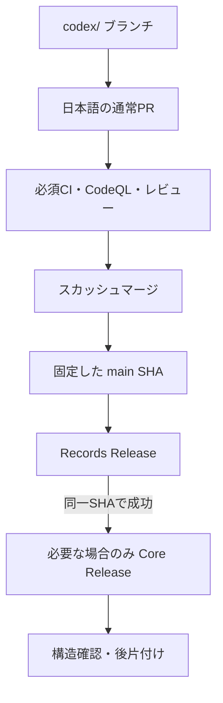
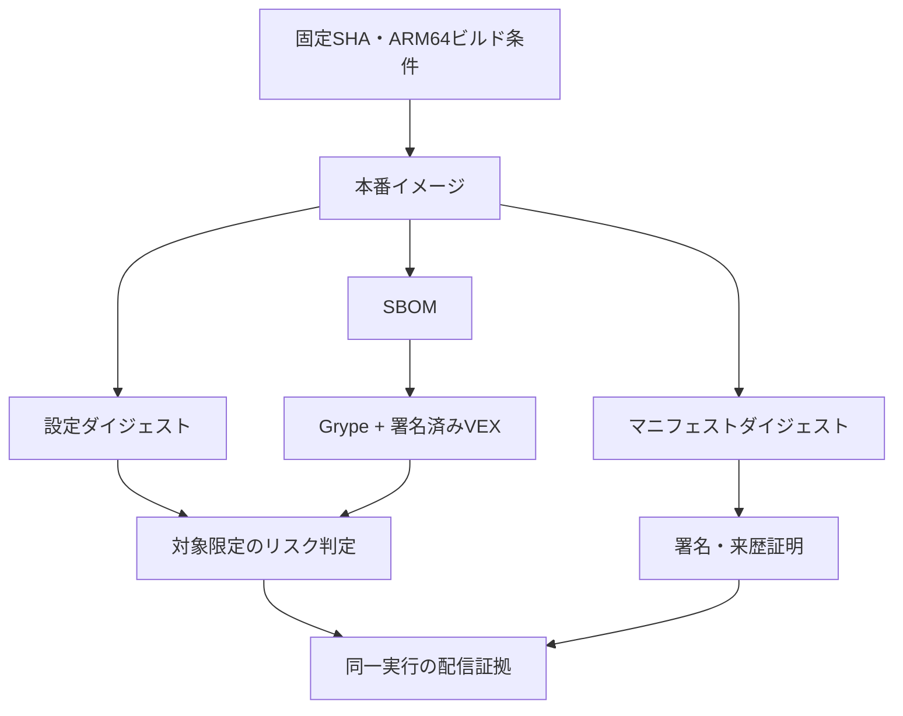
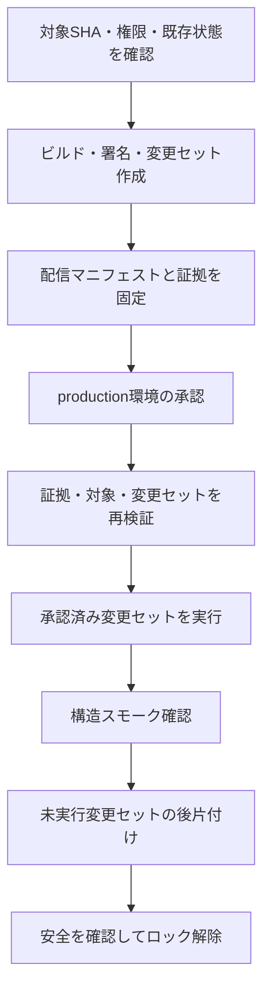

---
aliases:
  - The Shittim Chest GitHub詳細設計
tags: [project, shittim-chest, github, ci-cd, detailed-design]
status: current
created: 2026-07-16
updated: 2026-11-23
---

# GitHub・CI-CD詳細設計

[ドキュメント索引へ戻る](00_シッテムの箱_ドキュメント索引.md)

PRの検証、依存更新、署名した成果物の本番配信を扱う。

| 確認したいこと | 参照先 |
|---|---|
| 変更に必要な試験 | [試験・品質保証設計](18_試験・品質保証設計.md) |
| スタック・権限・データの所有範囲 | [AWS・CDK設計](14_AWS・CDK詳細設計.md) |
| 失敗時の調査と復旧 | [運用保守設計](17_運用保守・監視・障害対応設計.md) |
| 実際の配信・検証履歴 | [実装・試験・検証記録](20_実装・試験・検証記録.md) |

## 1. リポジトリと変更の流れ

公開リポジトリの既定ブランチは`main`。
ソース・IaC・ツール・サンプルはMIT、`docs/`と`AGENTS.md`は留保された文書として扱う。
秘密情報、非公開Discord識別子、質問、人格本文をコミット、成果物名、実行サマリーへ含めない。



`main`へ直接プッシュせず、下書きではない通常PRを使う。
GitHubへ書き込む前に`gh auth status`と`gh api user --jq '.login'`で操作アカウントを確認する。
完全SHAで許可されている外部Actionを更新する場合は、公式タグとの一致を確認し、リポジトリのAction許可リストへ同じSHAを追加する。
許可済みの旧SHAは既存mainの配信との互換性を保つため残し、SHA必須条件や許可元の範囲は広げない。
承認済みの工程は重ねて承認を求めないが、承認範囲を超える本番操作へ拡張しない。

### 変更対象の決定

配信とCIの範囲は[変更パス分類](https://github.com/pitekusu/shittim-chest/blob/main/tools/classify_ci_paths.py)と
実際の差分で決める。「Webだけ」「文書だけ」という呼び名だけでは判定しない。
例えばREADMEはイメージのビルド対象なので、その変更は現在の分類ではコンテナ検証対象になる。
Recordsだけの変更でFargateイメージを変更しない場合は、Core配信を追加しない。
Core配信を行う場合は、変更内容にかかわらず同じSHAのRecords配信成功が必要である。

検証フラグは依存関係に沿って分け、混在差分は必要範囲の和集合を使う。

| 変更入力 | 個別に実行する検証 |
|---|---|
| Records Python・専用lock | Records Python・契約 |
| Records公開契約 | Records Python・契約・Web |
| Records Web | Web。Pythonが参照するHTML・フォント・ライセンス入力はPython・契約にも伝播 |
| 共通インフラ・ルートnpm依存 | 共通CDK・Records synth |
| Coreソース・共有Python依存・Docker入力 | Core試験・package・コンテナ・Records Python・契約 |
| Coreの試験のみ | Core試験。コンテナ検証ツールはコンテナにも伝播 |
| Android | Android |
| docs・AGENTSのみ | 個別の重い検証は対象外。共通品質・公開情報・セキュリティ・CodeQLは継続 |
| 未知・空差分・分類基盤・手動全検証 | 全対象 |

既存の`core`・`records`・`runtime_container`・`android`出力名は維持し、
`core_tests`・`core_package`・`infra`とRecordsの4領域を個別出力する。
分類失敗や出力欠落は対象外にせず不合格とする。改名は旧名と新名の両方、削除は削除前のパスを分類する。

## 2. 継続的インテグレーション

GitHub-hosted runnerはUbuntu 26.04に固定する。x64は`ubuntu-26.04`、
コンテナ検証とCore／Records配信のARM64ジョブは`ubuntu-26.04-arm`を使う。
`ubuntu-latest`によるOSの自動切替は使わず、CPUアーキテクチャは維持する。

### Coreと共通検証

`ci.yml`はPR、`main`へのプッシュ、手動実行に対応する。
最初の`changes`が範囲を判定し、次の検証を必要な条件で実行する。

| ジョブ | 確かめるもの |
|---|---|
| quality | ロックファイル、整形、Ruff、ty、依存方向、ツール固定値 |
| tests | Pythonの単体・性質・永続化試験、DynamoDB Local |
| security | シークレット検査、依存監査、ソースSBOM |
| package | 再現可能なwheel/sdist |
| cdk | TypeScript、Vitest、cdk-nag、テンプレート生成、npm audit |
| container-arm64 | 本番イメージ、実行方針、SBOM、設定ダイジェスト |
| grype | 生スキャン、VEX適用、修正可能/残存リスクの判定 |
| docs-public-safety | 文書構造、参照、公開情報、ライセンス境界 |

uvを導入するworkflowは、完全SHAで固定した`setup-uv`に`require-checksums: true`を指定する。
Actionやuvを更新するときは、使うrunnerのOS・アーキテクチャに対応するchecksumがあることを確認する。

### tyのコードスキャン連携

Coreの`quality`とRecordsの`records-python`は、ty標準の`--output-format sarif`を使い、
結果をrunnerの一時領域へ出力する。既存の完全SHA固定`github/codeql-action/upload-sarif`で
`ty-core`／`ty-records`を別categoryとして登録し、リポジトリrootからの該当行を表示する。
tyの終了コードは維持し、型エラー時も結果を送信する。`continue-on-error`や`--exit-zero`は使わない。
`security-events: write`はこの2ジョブへ限定し、通常の`pull_request`イベントと標準tokenを使う。
別workflowへの成果物引継ぎ、`pull_request_target`による昇格、raw SARIFの汎用artifact公開は追加しない。

Coreの非同期試験は`pytest-asyncio`を使い、既存のfunction単位のfixtureに合わせて`asyncio_default_fixture_loop_scope = "function"`を明示する。未使用のAnyIO pytest pluginだけをpytest標準の`-p no:anyio`で自動登録対象から外し、runtimeのAnyIOを試験pluginの互換対応だけで更新しない。pytest 9.2で同pluginの旧`CallSpec2`参照が非推奨警告となっても、Coreの`warnings=error`、strict config／marker、pytest-asyncio・Hypothesis・coverageと既存試験は維持する。AnyIO固有のfixtureやbackendを試験へ導入する場合は、この除外と採用版のplugin互換性を再評価する。

### 標準プロファイラによるローカル計測

対象プロセスと同じPython minorの標準プロファイラを使う。利用できる標準sampling profilerでは、
同じ固定入力をwallとCPUで別々に計測してI/Oなどの待機とCPU処理を分ける。C拡張への帰属が必要な場合だけnative frameを有効にする。
短い固定fixtureは標準の `cProfile` でも計測できる。取得時と同じminorの `pstats` で結果を読む。

RecordsのOGPレンダラとLambda配布ZIPは、リポジトリルートから固定fixtureで計測する。

```sh
uv run --project services/records --frozen python -m services.records.tools.profile_workload ogp
uv run --project services/records --frozen python -m services.records.tools.profile_workload zip
```

`first_ms` は対象のimportと初回処理、`warm_median_ms` は同じプロセスでの再実行の中央値を示す。
同じ入力・Python・マシンで比較し、本番Lambdaの初期化時間はCloudWatchで確認する。

公開ソースと合成入力を使い、利用者の質問・生成結果・秘密値を計測しない。
結果の原本はprivate cacheへ保存し、共有する場合は端末のパスを除いた関数名・回数・時間だけを使う。
過去のコマンド例と合成入力の計測結果は[整理前の記録](https://github.com/pitekusu/shittim-chest/blob/d90665b0fc369b30f4960095bbb88dfa5bcc36ea/docs/15_GitHub・CI-CD詳細設計.md#標準プロファイラによるローカル計測)を参照する。

### Records検証

| ジョブ | 確かめるもの |
|---|---|
| records-changes | Recordsの変更範囲 |
| records-python | 固定依存、監査、整形・型・単体・DynamoDB Local |
| records-contract | OpenAPI、JSON Schema等の生成物一致 |
| records-web | 整形・型・単体試験・ビルド・Playwright・依存監査 |
| records-infra | Records固有スタックのテンプレート生成 |
| records-gate | 必須チェックとしてRecords全体の結果を集約 |

Records WebのビルドはCI・Records Releaseとも、Webプロジェクト内で`pnpm run build`を実行する。
フォント原本・分割WOFF2・生成CSSのchecksum、Vite+ build、遅延ルートの所有境界と各HTML入口の初期static import closureのgzip上限、公開2ページの初期HTMLメタデータを一括して検証し、直接`vp build`だけを実行して前後の検証を省かない。

Records CIのPlaywrightが失敗した場合だけ、`test-results`内の`*-actual.png`・`*-expected.png`・`*-diff.png`を固定したupload-artifact Actionで7日保持する。
trace・動画・HTML report・他の添付画像はアップロードしない。比較画像がない失敗では保存を省くが、元のブラウザー試験の失敗は成功に置き換えない。

ルートのロックファイル監査、TypeScript、Recordsを含む全インフラのVitestは同じSHAの`cdk`へ集約する。
`records-infra`では共通検証を繰り返さない。
対象外PRでも`records-gate`は明示的な対象外の成功結果を返す。
`tests`・`package`・`cdk`・`android-gate`・`container-arm64`・`grype`は、必須チェックと実処理を同じジョブで実行する。
分類成功と明示的な対象フラグを先に検証し、対象外だけ重い処理を省く。終了時には必要な試験・成果物の
step outcomeとconclusionを検査し、未実行・失敗・キャンセルやcontinue-on-errorによる失敗の隠蔽を通さない。
対象外と実行成功は各ジョブのSummaryで区別する。
Playwrightの環境、代表画面の比較、調査用成果物は[試験設計](18_試験・品質保証設計.md)を参照する。

### Webで失敗した試験だけを再実行する

Webの同じ名前の失敗testを修正している間は、project内で次を使う。
`test:failed`はVitestの標準`--last-failed`だけを呼ぶaliasであり、独自cacheや自動fallbackを持たない。

```bash
cd apps/records-web
pnpm run test:failed
```

標準results cacheに直前の失敗がない場合は終了値1となる。
`--passWithNoTests`を加えて成功へ置き換えない。
失敗testの名前を変えると選択から外れ、実行0件でも終了値0になる場合があるため、
testの追加・改名、失敗履歴がない場合、変更完了前にはflagなしで全件を実行する。

```bash
pnpm exec vp test run
```

CIと`verify`は既存の全件試験を維持し、このaliasへ置き換えない。
選択と終了値は[Vitestの仕様](https://vitest.dev/guide/cli.html#last-failed)に従う。

### ローカルでブラウザー試験の失敗ログに絞る

試験件数を変えずに、失敗と再試行の診断を確認する場合は、Playwright標準の`failures` reporterを選ぶ。

```bash
cd apps/records-web
pnpm run test:e2e --reporter failures
```

試験の選択は維持したまま出力を絞る。[Playwrightのfailures reporter](https://playwright.dev/docs/test-reporters#failures-reporter)を参照する。

### CodeQLの既存3言語の移行とAndroid追加

[codeql.yml](https://github.com/pitekusu/shittim-chest/blob/main/.github/workflows/codeql.yml)のadvanced setupでPython、JavaScript/TypeScript、GitHub Actions、Java/Kotlinを
`security-extended`で解析する。Java/Kotlinは `manual` で `:app:assembleDebug` を実行し、実ソースを抽出する。他の3言語は `none` を使う。
Android抽出はキャッシュ済み出力や差分コンパイルに頼らず実行し、Kotlin更新時もPRと同じ変更のmainで4言語の解析・送信を確認する。

PR、mainへのpush、定期実行、手動実行が対象。共通配信判定では `Analyze (java-kotlin)` を含む全4言語の成功が必要。
default setupからの移行判断と当時の抽出結果は[整理前の記録](https://github.com/pitekusu/shittim-chest/blob/d90665b0fc369b30f4960095bbb88dfa5bcc36ea/docs/15_GitHub・CI-CD詳細設計.md#codeqlの既存3言語の移行とandroid追加)を参照する。

### Android検証（C03）

Androidは同じ`ci.yml`の`android-gate`で検証し、独立した大規模matrixは作らない。

| 検証 | 内容 |
|---|---|
| ツールチェーン | JDKはAndroidの`.java-version`、GradleはWrapper、SDK／Build Toolsはアプリの固定値と一致 |
| ビルド・静的確認 | debug APK、テストAPK、Android Lint |
| 通常の端末試験 | API 36 x86_64のエミュレーター1台で認証・鍵・暗号化保存・DB・API・同期などの非画面instrumentation test |
| 画面・操作の確認 | 既存試験を保持し、UI変更時と配布前に対象を選んで実行。手動CIの`android_screen_tests`で全試験を選択可能 |
| 結果 | `android-gate`で分類成功と実行済みJUnit結果を確認。結果欠落・0件・失敗・取消・skipは不合格 |
| 成果物 | Lint・テストのレポートのみ7日保持。APK配布・署名・Play認証は行わない |

通常のPRとmainではAndroidJUnitRunnerの `notAnnotation` で `@ScreenTest` を除く。
UI変更時・配布前には関連する画面試験を選び、手動CIで全件を確認する場合は `android_screen_tests` を使う。
Gradle、システムイメージ、AVDのキャッシュはmainだけが保存する。cache hitでも試験を実行する。

### Web・CDKのツール実行

Records WebのCIとReleaseは同じ固定 `setup-vp` でNode・Vite+・pnpmを選び、
`packageManager` と実行中pnpmの完全一致を確認して `vp install --frozen-lockfile` を実行する。
キャッシュの保存はmainだけとし、検証に失敗した場合は通常の導入へ戻す。
パッケージ・lock・workspace設定・関係するnpm設定が変わる場合と手動全検証では `pnpm audit signatures` も実行し、署名検証失敗は不合格とする。

書式・lint・型は `pnpm run check` に集約する。workspace外にある共有契約やnpm設定も検証入力であるため、通常の検証では依存キャッシュとタスク結果キャッシュを区別する。
CDKをローカルで修正中は `npm run test:infra:failed` で直前の失敗を再確認できる。CIは対象の全件を実行する。
`npm run synth` または `npm run synth:records` の後に `npm run cdk -- explore --output cdk.out` を実行すると、ブラウザーでconstruct構成とCloudFormationテンプレートを確認できる。

### Androidクローズドテスト配布（C39）

[Android Closed Release](https://github.com/pitekusu/shittim-chest/blob/main/.github/workflows/android-release.yml) は `main` のSHAを指定する手動配布である。同一SHAの最新CI・Records CI・CodeQLを確認し、署名と内容を検証した同一AABだけをクローズドトラック `alpha` へ提出する。Play API認証はGitHub OIDCからの短寿命資格情報を使い、AAB署名用の鍵と分ける。

資格情報の設定、必須の日本語更新情報、提出後の照合、競合・応答不明時の調査は [Androidアプリ設計](29_Androidアプリ設計.md#c39クローズドテスト配布の自動化) に定める。提出結果の照合、Playの審査・公開状態、実機更新はそれぞれ確認する。

### npm監査サービスの障害

`npm audit`/`pnpm audit`は通常どおり必須である。
Coreの`npm run audit:infra`とWebの`pnpm run audit`は、各監査の完全なJSONを
共用の`infra/check-audit.mjs`へ渡し、package・advisory・severityが一致する未失効の受容だけを適用する。
例外の`expires`は`YYYY-MM-DD`形式の実在する日付を指定する。`Temporal.PlainDate`でUTCの当日と比較し、指定日00:00 UTCから失効する。
受容ファイルはinfraとWebで分け、別projectの受容を流用しない。pnpm形式の読取を共用gateへ追加し、
期限切れ・未知の検出・不正な応答・未使用の例外は従来どおり拒否する。
CIとRecords Releaseは、このpackage scriptを既存のnpm障害確認ラッパー経由で実行する。
npm公式Statuspageで「Security Auditコンポーネントの劣化」と「同コンポーネントに紐づく進行中インシデント」を
同時に確認できた実行だけ、Node系の外部監査を省略し、警告を残す。
公式情報の取得失敗・不正な形式・インシデント不明は拒否し、監査で検出された脆弱性や通常の非0終了を省略理由にしない。
ビルド、試験、CodeQL、Grype、依存レビュー等は継続する。省略した監査を成功として記録しない。

### CDK依存の期限付きリスク受容

ID・パッケージ・重大度・理由・期限の正は`infra/npm-audit-exceptions.json`とする。
npm標準reportの`via`がパッケージ名を参照する場合は、参照先のadvisoryまでたどって照合する。
参照欠落・循環・空または不正なmetadataは拒否し、例外のパッケージ名は参照元の依存元でなくadvisoryを持つ末端へ束縛する。
未知ID、パッケージ／重大度の不一致、期限切れ、未使用の例外は拒否する。

受容の追加は承認された対象と期限に限る。親依存が修正版を選べるようになった場合は実際の解決結果を確認して受容を削除し、通常の監査を行う。
CDK同梱minimatchの受容は、aws-cdk-lib 2.278.0の公式npm配布物で修正版を確認した時点で削除した。
過去の判断は[整理前の記録](https://github.com/pitekusu/shittim-chest/blob/d90665b0fc369b30f4960095bbb88dfa5bcc36ea/docs/15_GitHub・CI-CD詳細設計.md#cdk依存の期限付きリスク受容)を参照する。

## 3. 依存と配信ツールの更新

採用バージョンはロックファイル、プロジェクト設定、ワークフローの固定値を参照する。
Dependabotの対象、頻度、cooldownと例外は[設定ファイル](https://github.com/pitekusu/shittim-chest/blob/main/.github/dependabot.yml)で管理する。

| 更新対象 | 一緒に確認するもの |
|---|---|
| Python | `.python-version`、両プロジェクトの制約・lock・Ruff、uv、CDKのLambda runtime、ARM64 wheelとコンテナ |
| Node | 26系。 `.node-version`、ルートとWebの `engines`、固定CIツール、Node型、CDK・Webの互換性 |
| Vite+ | 本体・coreエイリアス・Vitest override・pnpm設定・契約生成 |
| OpenAI SDK | Core／Recordsの共有制約、HTTPクライアント・タイムアウト・例外境界 |
| uvとビルドバックエンド | 両Pythonプロジェクトの対応系列、`required-version`、`uv_build`、CI、Docker、監視 |
| Actions | 完全コミットSHAと上流タグ、リポジトリの許可済みSHA |
| Android | Gradle Wrapper配布・チェックサム、KotlinとCompose Compiler、Compose BOMとMaterial 3、依存グラフ |
| コンテナ・直接取得CLI | 対象アーキテクチャ、固定ダイジェスト・チェックサム、署名、実際の読み込み元 |

依存の導入・更新に伴い、対応範囲のビルドと試験を通す。コンテナが変わる場合は完成イメージのSBOM、VEX、スキャン結果を照合し、期限付き受容は対象のダイジェストを確認する。
AGPなどの間接依存へ修正版の制約を設ける場合は実際の依存グラフで確認し、親依存の更新で制約が不要になった場合は撤去を検討する。

Dependabotだけでは揃わないVite+のエイリアスとoverrideは専用の整合性検査で確認する。
別経路の更新後に同じDependabot PRが後続ダイジェストを吸収した場合は、必要に応じて既存PRを再評価または再作成し、更新後の差分を確認する。

### eMudhra／emSign中間CA侵害への対応（2026年10月21日）

証明書とホスト名の検証を維持し、各経路が実際に使う信頼集合を確認する。

| 経路 | 維持する検証 |
|---|---|
| Core／Recordsの外部HTTPS | アプリが選ぶcertifi、botocore同梱fallback、明示CAパスを別々に確認 |
| CI・ビルド | checkout前のOSストア、固定ツール設定、子プロセスへ渡すCAfileとCApath、Docker／BuildKitの実設定を確認 |
| 完成本番イメージ | OS既定、CApath、アプリcertifi、botocore fallbackの4系統を同じARM64イメージで検証。対象12件の拒否と正常3件の受理を各系統で確認し、結果をSBOMと同じ成果物に残す |
| CDKの補助Lambda | AWS管理ランタイムの配布状況を別途確認し、アプリのbundleの結果を流用しない |
| Android | アプリのOkHttp／CoilがHTTP送信前に対象の公開鍵を拒否する。SDK独自通信、ブラウザー、OS側失効の到達状況は個別に扱う |

TLSの接続障害、期限切れ、ホスト名不一致を対象証明書の拒否と取り違えない。
VPCのdefault security groupを制限するCDK補助関数はmanaged `nodejs26.x` を使う。署名付きアセット証跡はschema v3で補助関数のランタイムを検証し、旧schema v1（TLS Layer付き）とv2（Node.js 24）も照合できる。

各CAの実体・旧Layerの撤去判断・試験記録は[整理前の記録](https://github.com/pitekusu/shittim-chest/blob/d90665b0fc369b30f4960095bbb88dfa5bcc36ea/docs/15_GitHub・CI-CD詳細設計.md#emudhraemsign中間ca侵害への対応2026年10月21日)を参照する。

### Pythonの実行環境

Core／Recordsと配布・検証ツールはPython 3.15系を使う。パッチ版は `.python-version` と各ワークフロー、CoreのDHIはDockerfileの固定digestを参照する。対象のLambda Event FunctionsはCDKの `Runtime.PYTHON_3_15` を使い、実配信の適用はLambdaのランタイム情報で確認する。[AWSの正式対応](https://aws.amazon.com/about-aws/whats-new/2026/11/aws-lambda-python-315/)

Python minorの更新では、両lock・ネイティブ依存・Lambda runtime・DHI・コンテナポリシーを揃える。両lockで `jiter` を含むARM64向けビルド済みwheelを解決し、完成イメージ、CDK、同一SHAのCIを検証する。
当時の配布・互換性調査は[整理前の記録](https://github.com/pitekusu/shittim-chest/blob/d90665b0fc369b30f4960095bbb88dfa5bcc36ea/docs/15_GitHub・CI-CD詳細設計.md#python-315への移行評価2026年10月14日)を参照する。

### 固定ツール監視

DependabotのActions更新は`uses:`を扱い、`with.version`、`driver-opts`、環境変数、直接取得CLIの固定値を網羅しない。
これらは`Release Tool Versions`が毎週と手動実行で確認する。

- `.github/tool-versions.json`の`tools`は配布物・チェックサム・署名主体の正本。
  `sources`はワークフロー/パッケージ管理設定の参照先であり、同じバージョンを複製しない。
- 通常CIはネットワークを使わず、固定値の形式と複数箇所の整合を検査する。
- 定期監視は公式リリースの安定版を、明示したPython/Node/uv/pnpm系列の中で比較する。系列変更を自動採用しない。
  Temurinは採用JDK系列の公式リリース、Android SDK PlatformとBuild ToolsはGoogleの正式配布一覧を確認する。
  Vite+のCLIはGitHub Release、独立した版番号を持つcoreは公式npm registryの安定版を比較する。
  coreエイリアスと固定overrideも実ファイルから読み、不一致を拒否し、互換性のため保留中の更新を通知から漏らさない。
- AWS Signerのインストーラーは`latest`配布物・署名・公開鍵のチェックサム差分だけを検出する。
  取得したツールの実行・インストール・署名鍵の自動交換はしない。
- Git履歴の秘密検査で公開チェックサムを誤検出した場合は、公式配布物のSHA-256を照合したうえで、
  対象ファイル・項目名・既知の値が全て一致する行だけを除外する。ECR Credential Helperの
  ARM64版0.12.0と0.13.0もこの範囲で扱い、別の値や他のファイルへの除外へ広げない。
- 結果は実行サマリーと通知Botが管理する単一Issueへ集約する。変化がなければ再投稿しない。
  全項目が確認済みで最新の場合だけIssueを閉じ、一部取得失敗を「最新」にしない。
- 終了値は最新`0`、更新候補あり`1`、取得/設定不正`2`。
  `main`限定で`contents: read`と`issues: write`を使い、書換え・自動マージ・AWS操作・配信開始はしない。

### 固定ツールの更新調査

公式配布の実体・署名・チェックサムを新旧で照合し、組み合わせと対象アーキテクチャを確認してから固定値を変更する。
未解決の更新は[固定ツールの追跡Issue](https://github.com/pitekusu/shittim-chest/issues/700)で確認する。
日付別の検証、Gradle配布ZIPの手動監査結果、採否の根拠は[整理前の記録](https://github.com/pitekusu/shittim-chest/blob/d90665b0fc369b30f4960095bbb88dfa5bcc36ea/docs/15_GitHub・CI-CD詳細設計.md)にある。

## 4. イメージと成果物の信頼性

### 配布ZIPの3世代保持

共有CDKアセットバケットのLambda配布ZIPは、Core・Recordsごとに**現行＋直近2種類**を残す。
同じキーの再アップロードは世代に数えず、使わない旧オブジェクトバージョンも削除する。
世代の順序はZIPの最新登録日時とするため、配信前に作られたZIPも直近の候補に含まれる。
本番CloudFormationが参照するキー・バージョンは常に保護し、Core補助LambdaのZIPはRecordsの世代数に含めない。
Recordsは配布ZIP内の`shittim_records/__init__.py`の存在で識別し、参照が外れた古いCore補助ZIPも除外する。
ZIPはVersionIdを固定してメモリ内で読み、ファイルを展開・実行・ログ出力しない。128 MiB超過や破損時は整理を停止する。
JSONテンプレート、Web配信アセット、ECRイメージ、利用者データはこの整理の対象外である。

`tools/prune_release_bundles.py`を、各リリースの配信・検証が成功した後に実行する。
共通の`production-release`排他内で、安定したRuntime/Applicationスタックと未実行変更セットがないことを確認し、
dry-runの計画ハッシュを再照合してから、正確なキーとVersionIdで削除する。
整理失敗はワークフロー上で失敗として示すが、検証済みの本番配信を巻き戻さない。
削除済み世代のZIPはS3から復元できない。保持範囲外の再配信には再ビルドが必要になる。

事前にReleaseIdentityへ、配信ロールごとの対象ZIPに限定した`DeleteObjectVersion`、
バケットのバージョン一覧・設定読取、両スタックの参照確認権限を反映する。
Records配信ロールには、分類のため同じZIP範囲だけの`GetObjectVersion`も許可する。
バケット削除、保持ロック回避、テンプレート削除の権限は追加しない。



本番イメージは固定SHAから共通のARM64パス・Docker出力形式で作る。
設定ダイジェスト（config digest）、SBOM、VEX、Grype、リスク結果を同一SHA・実行の成果物として照合する。
マニフェストダイジェスト（manifest digest）と設定ダイジェストは別物であり、一方から他方を推測しない。

PRの必須条件として固定された旧基準値や別実行との完全な設定ダイジェスト一致を要求しない。
例外承認を必要とする脆弱性だけ、本番イメージ種別、検出項目、実測の設定ダイジェスト、期限へ結び付ける。
同じ種別の独立ビルドには有限個のダイジェストを登録できるが、未登録のものは拒否する。
修正可能な高・重大の脆弱性は拒否し、残存リスクは検証済みVEXまたは期限付き承認だけを認める。
同じベースイメージでもベンダーのVEX判定は更新される。以前の「影響なし」がなくなった場合は、
過去のVEXや承認範囲の拡大で通さず、修正版のベースイメージと最新の検査結果を確認する。

### SBOM・VEX・期限付きリスク受容

CIとCore Releaseは、固定したDocker公式公開鍵でDHIのindexとARM64のattestation manifestを照合し、署名済みSPDX／OpenVEXを原本のまま保存する。
SPDXはScoutでも独立に検証する。検証ツールと配布物のチェックサムは固定する。

提供元の `not_affected` を派生VEXに使う場合は、署名した原本から完全なバイナリPURL・版・実ファイルSHA-256による対応を確認する。
dpkgのSource名と版がともに省略される場合は、Debian Policyに従ってPURLと整合するバイナリのPackageとVersionを使う。この場合も、署名付きSPDXの同名・同版ノードからpackage verification codeと所有ファイル全体のSHA-256が一致する唯一のノードを選ぶ。[DebianのSource規則](https://www.debian.org/doc/debian-policy/ch-controlfields.html#source)

同名の別版、変更されたファイル、照合に必要な情報の欠落、矛盾する判定では適用しない。Debianの `no-dsa` とtracker URLだけでは非影響の根拠にならない。
原本、比較用inventory、完成SPDX、対応レポートと入力ハッシュを保存し、配信前に派生VEXとレポートの再計算が一致することを確認する。

GrypeのDBキャッシュには版・OS・UTC日付を用いる。キャッシュがあっても `db update` の成功を要求し、実スキャン、署名済みVEXの取得、ARM64での再検証を行う。
CIとCore Releaseは `docker image save` 内のconfig実体をSHA-256で測定し、配信時はECR manifestの `config.digest` と一致させる。
ビルドで使うbytecode・時刻・ファイルなどの再現性に関わる設定はDockerfileとコンテナ検証で管理する。

修正可能なHigh／Criticalは不合格。未修正リスクの承認は、該当項目、パッケージと実測config digest、根拠、期限、削除条件を `security/container-risk-acceptance.json` へ記録する。
ベンダー修正済みでスキャナーDBへの反映だけが遅い場合は、公式の修正版と実イメージのSBOMを照合する。
期限はUTCの最終有効日までで、承認日から最大90日とする。登録できるdigestはイメージ種別ごとに最大4個。
正式修正・新しい検出・パッケージやdigestの変更・期限到達で再評価する。
同じ系統でも別digestや別イメージへ承認は広げない。対象が解消した承認は削除する。

`fault-test` イメージと強制停止・復旧訓練は明示的なRuntime検証に限る。
現在のリスク判定では、設定ファイルと実測したconfig digest、検出項目、UTC期限を照合する。Python 3.15.2への移行時に承認した15組の内訳と期限は[PR #791の受容記録](https://github.com/pitekusu/shittim-chest/blob/d90665b0fc369b30f4960095bbb88dfa5bcc36ea/docs/15_GitHub・CI-CD詳細設計.md#python-3152の完成arm64イメージの受容)を参照する。

日付別のスキャン結果と承認の根拠は[整理前の記録](https://github.com/pitekusu/shittim-chest/blob/d90665b0fc369b30f4960095bbb88dfa5bcc36ea/docs/15_GitHub・CI-CD詳細設計.md#4-イメージと成果物の信頼性)を参照する。

## 5. 本番配信

### 共通の工程



手動ワークフローは`main`の固定SHAを使う。CoreはRuntimeConfigのバージョンも入力する。
Core／Records Releaseは共通スクリプトで、固定したmain SHAに対するCI・Records CI・CodeQLの
最新run／attemptを確認する。対象はmainのpush・手動・定期実行であり、PRの同名チェックは採用しない。
10個の必須チェック名とCodeQLの4言語を全件照合し、未完了・失敗・キャンセル・欠落・重複を不合格とする。
workflowとjobの一覧は全ページを取得する。既存の承認後の証拠照合と同一SHAのRecords→Core順序は維持する。

開始前にOIDCのリポジトリ識別情報、必須mainチェック、CodeQL、非公開設定のメタデータ、
スタック、残存変更セット、ロック、Runtimeの稼働状況を確認する。
環境への配信承認は利用者が許可した範囲内で実施する。

### Records配信

配信マニフェストのスキーマv4は、東京のStateful/Applicationとバージニア北部のEdge変更セット、
Lambdaバンドルのハッシュ、再現可能なWeb ZIPのハッシュ、公開ホスト名を同じ`main` SHAへ結び付ける。
Lambdaのbase64 SHA-256は既定値のないCloudFormationパラメーター、変更セット、マニフェスト、
公開Lambdaバージョンへ一貫して渡し、計画時と配信時の両方で照合する。

1. Records Python/Web成果物とStateful → Application → Edgeの変更計画を固定する。
2. 元Runtimeスタックから`RuntimeConfigVersion`を読み、`vNNNN`を検証してApplicationへ渡す。
3. 一時アップロードバケットの正確なS3オリジンをEdgeへ渡す。
   公開ホスト名は本番CORSオリジンと完全一致させ、マニフェストにも固定する。
4. 承認後に変更を配信し、Application/Edgeのパラメーターと公開オリジンを照合する。
5. 匿名の`GET /api/v1/admin/prompts`が401と`private, no-store`を返す等の構造確認を行う。

モバイル認証は匿名の`GET /api/v1/auth/mobile/session`と`POST /api/v1/auth/mobile/logout`について、
401・`private, no-store`・Bearer challengeを確認する。tokenを渡さないためセッションの作成・削除は行わない。
App Linksの実機確認はAndroid配布工程で別に実施し、Release smokeで実Discordログインを開始しない。

Androidの議論開始は専用Lambdaを配信しても初期無効とする。同一SHAのRecords→Core公開後にのみ有効化し、実投稿・有料生成を通常smokeへ追加しない。
Records Applicationの既存開始フラグ・投稿先は`UsePreviousValue`で維持し、初回だけ無効／未設定を明示する。
開始フラグ変更は公開Lambda versionの更新へ結び付ける。投稿先の変更は無効化→変更→再有効化の順で行い、非公開設定を説明・ログへ出さない。

変更セットは次の条件で扱う。

| 対象 | 受理する条件・処理 |
|---|---|
| 作成/更新の区分 | 作成前のスタック状態から決め、`CREATE`/`UPDATE`としてマニフェストへ固定。`DescribeChangeSet`から推測しない |
| 実行対象 | `CREATE_COMPLETE / AVAILABLE`のみ |
| 変更なし | `FAILED / UNAVAILABLE`かつ変更なしと判定できる場合、正常な処理不要として記録し、承認待ち前に削除 |
| 変更のないスタックの安定状態 | `CREATE_COMPLETE`、`UPDATE_COMPLETE`、`UPDATE_ROLLBACK_COMPLETE`、`IMPORT_COMPLETE` |
| 終了保護 | 各スタックの更新または変更不要の確認直後に明示的に有効化し、再取得で`true`を確認してから次へ進む |

CDKを介さず変更セットを直接実行するため、CDKメタデータだけを実際の終了保護の証拠にしない。
`ROLLBACK_COMPLETE`は受理せず、初回作成失敗の後始末は[運用手順](17_運用保守・監視・障害対応設計.md)に従う。

Webは配信直前にZIPの署名/ハッシュと固定SyftによるSBOMハッシュを再検証する。
CI用の`records-code-splitting.json`はbuild出力に保持してJS予算・ルート分割を検証し、公開用ZIPからだけ除外する。
公開ポリシーと削除申請の固定2 HTMLも同じ署名済みZIPから配信し、通常入口・App Linksファイルと合わせてキャッシュ無効化と前版復元へ含める。公開HTMLの前版がない初回の復元は、認証・スクリプト・外部リンクを含まない固定の準備中HTMLへ置換する。通常入口の前版の有無によらず、公開ページではセッション照会を発生させない。既存の読込・書込権限で対応し、公開2 HTMLの削除権限は追加しない。
公開ZIPには `index.html`、ハッシュ付き `assets/`、`.well-known/assetlinks.json`、プライバシーポリシー・削除申請のHTMLを含める。
ハッシュ付きアセットを先に配置し、`index.html` を最後に更新する。CloudFrontでは通常入口、App Linksファイル、公開2ページの経路を無効化する。
過去のハッシュ付きアセットは即削除しない。公開後のスモークが失敗した場合は、直前のバージョン付き
`index.html`を戻して再無効化する。回復はLambdaエイリアス、S3オブジェクトバージョン、
CloudFront無効化を使い、Archiveや親愛度レコードを削除しない。

Lambdaのネイティブ依存は、配信先のPython minorに対応する `aarch64-manylinux_2_28` 向けのビルド済みwheelをハッシュ付きで解決する。
x86_64の実行環境で得たPillow等のネイティブ拡張を混入させない。
プロンプトの有効参照先の初回作成、アップロード、画像生成、親愛度リセットは配信処理では行わない。
匿名の疎通確認では、セッションの200と`no-store`、`Set-Cookie`なし、記録一覧の401も確認する。
OAuth開始は状態の書込を伴うため自動実行しない。Records配信ではECRへの登録やFargateビルドを行わない。

### Core配信

同じSHAの最新の完了済みRecords Releaseを選ぶ。その最新試行が失敗なら、過去の成功へ戻って選び直さない。
最新の選定は更新時刻、実行ID、試行番号で固定する。
実行ID/試行番号、署名主体、ソースダイジェスト、マニフェストを検証し、RecordsマニフェストをCoreの証拠へ同梱する。
配信側でも再検証し、ホスト名は各処理がそのマニフェストから直接読む。
シークレットマスクで消える可能性があるジョブ間出力や変更可能なリポジトリ変数へ依存させない。

Coreは本番イメージを再ビルドし、同じ実行のダイジェスト・署名・脆弱性判定を確認する。
参照成果物を追加する前に既存一覧を保存し、差分から今回の来歴・SBOM・脆弱性証明を各1件特定する。
過去の参照成果物は削除しない。

承認後、配信ロックを原子的に取得して署名済み変更セットだけを固定順で実行する。
構造スモークはスタック、ECSタスク数、候補イメージ、Image Admission、メモリアルURLの設定を確認する。
実際のDiscord討論やOpenAI生成は別の受入操作である。

### スキーマとロックの収束

| 判定段階 | 必須条件・処理 |
|---|---|
| 事前確認 | 制御レコード11件が現行または直前スキーマで均一。不明・混在は拒否 |
| ロック取得 | 直前スキーマの場合、ロックと全件の現行化を同じトランザクションで行う |
| 候補Runtimeの適用確認 | スタックが安定し、サービスが正確な候補イメージを参照すれば現行スキーマを維持 |
| 旧Runtimeのまま | 安定した旧構成と確認できた場合、制御レコードを直前スキーマへ一括で戻す |
| 状態が曖昧 | ロックを保持し、追加調査へ進む |

スキーマの前後・移行有無・ロック判断だけを本文なしの証拠に残す。
後片付けの成功で元の配信失敗を成功へ変えない。
ReleaseIdentity更新、失敗したワークフローの再実行、手動CloudFormation配信は通常配信へ暗黙に含めず、原因と副作用を確認して判断する。

## 6. 定期実行と秘密情報の保護

| ワークフロー | 頻度 | 役割 |
|---|---|---|
| Infrastructure Drift | 毎週火曜 | Core 5/Records 3スタックの構成差分を検出。自動修復なし |
| Dependency Graph | 毎週火曜・Android変更時 | Core・Records・Webフォント生成のPython依存一覧を照合し、Androidの解決済み依存をGitHubへ送信 |
| Release Tool Versions | 毎週水曜 | 固定ツールの更新候補を通知 |
| Discord Security Digest | 毎日 | セキュリティ情報を補助通知 |
| Discord通知 | 対象イベント発生時 | PR/対象ワークフローの状態を補助通知 |

Dependency Graphでは、Core・Records・Webフォント生成の3プロジェクトの全依存グループをfrozenでCycloneDX 1.5へ出力し、
各lockfileとの一致を検証したうえで、和集合をGitHubのSPDX内のPython依存と比較する。
パッケージとして導入しないフォント生成プロジェクトのvirtual rootも、名前・版・唯一のrootという同じ条件で検証する。
RecordsからCoreへのローカル参照は、比較に含めたプロジェクトのパス・名前・版が一致する場合だけ認める。
不足・余分な依存は失敗とし、反映待ちは最大5回・60秒間隔とする。API取得にも時間制限を設け、
比較失敗時も取得済みのCore・Records・Webフォント生成・GitHubのSBOMを保持する。mainが進んだ場合は比較を破棄する。

Androidは`gradle/actions/dependency-submission`で依存解決結果を送信し、Dependabot alertsとsecurity updatesの対象にする。
送信は`main`限定の専用jobに`contents: write`を与え、PRのコードへ書込権限を渡さない。
Gradleの直接依存は更新PRの対象になるが、推移的依存だけの警告では親依存や制約の更新が必要になる場合がある。

### 生徒募集の名簿

名簿の正本は `data/student-gacha/blue_archive_characters_with_npcs.json` とする。
[キャラクター一覧](https://bluearchive.wikiru.jp/?cmd=read&page=%E3%82%AD%E3%83%A3%E3%83%A9%E3%82%AF%E3%82%BF%E3%83%BC%E4%B8%80%E8%A6%A7)の星1で入手欄に◇がある場合はレアリティ3とする。
[NPC一覧](https://bluearchive.wikiru.jp/?cmd=read&page=NPC%E4%B8%80%E8%A6%A7)のキャラクターと衣装替えはレアリティ0とし、
シッテムの箱所属のアロナとプラナをレアリティ0から除外する。既存のレアリティ4は保持する。
名前に「水着」を含むキャラクターは、登録済みの行も含めて次回の月次照合で除外する。
取得や構造の検証に失敗した場合、既存名簿を保護して終了する。

`shittim-student-gacha-roster.timer` は毎月1日09:17（日本時間）に起動する。
`tools/systemd/` のserviceとtimerをユーザーのsystemdへ登録し、同じ版の
`tools/maintain_student_gacha_roster.py`、`tools/update_student_gacha_roster.py`、
`tools/check_release_ci.py` をserviceの作業ディレクトリの `tools/` に置く。
既存のGitHub CLI所有者ログインを使うため、資格情報を追加で保存する必要はない。
名簿に差分がある場合はJSONだけを変更するPRを作成し、必須CIとCodeQLを待ってsquash mergeする。
タイマーが途中で失敗した場合は保存したPR番号・配信runから再照合して再開できる。
Wiki照合だけを実行する場合は `python -m tools.update_student_gacha_roster`、
ネットワークを使わない形式検証には `--check` を使う。

初回はReleaseIdentityに名簿専用ロールを作成し、GitHub Environment `student-gacha-roster` を
`main` に限定する。`STUDENT_GACHA_ROSTER_RELEASE_ENABLED=true` を設定したら、同一SHAの必須CI成功後に
`Student Gacha Roster Release` を `expected_sha` 付きで実行する。
既存の非公開・バージョニング済みメディアバケットの `student-gacha/roster/` 配下にある名簿1件に限り、
条件付きで更新し、S3から同一バージョンと現在のバージョンを再取得してチェックサムと内容を照合する。
この初回配信と読み戻しを済ませてから同じキーを読むCoreを配信する。
以降の名簿だけの差分は同じActionsで反映する。
専用素材を読むコードや権限の変更を含む追加では、素材の準備と同一SHAのRecords・Coreの配信を済ませてから名簿を配信する。
CoreとRecordsのコード配信には既存の本番承認を適用する。

正確な時刻・対象・権限は[ワークフロー定義](https://github.com/pitekusu/shittim-chest/tree/main/.github/workflows)、
通知の挙動は[通知運用設計](21_GitHub・Discord通知運用設計.md)を正とする。
ソース取得は`persist-credentials=false`、権限はジョブ単位で最小化する。
信頼できないPRのコードへAWS資格情報、本番環境の秘密、DHI資格情報を渡さない。
成果物には保持期限を設定し、取得後にダイジェスト・スキーマ・SHAを再検証する。
アテステーションURLの公開サマリーでは、公開リポジトリ所有者を意図せずマスクしない。

## 実装への入口

| 対象 | 実装 |
|---|---|
| Core配信 | [release.yml](https://github.com/pitekusu/shittim-chest/blob/main/.github/workflows/release.yml) |
| Records配信 | [records-release.yml](https://github.com/pitekusu/shittim-chest/blob/main/.github/workflows/records-release.yml) |
| 証拠の検証 | [release_supply_chain.py](https://github.com/pitekusu/shittim-chest/blob/main/tools/release_supply_chain.py)、[records_release_manifest.py](https://github.com/pitekusu/shittim-chest/blob/main/tools/records_release_manifest.py) |
| ロック・スキーマ | [control_records.py](https://github.com/pitekusu/shittim-chest/blob/main/tools/control_records.py) |

## 公式資料確認記録

以下は設計時の確認記録であり、文書整理による再確認を示さない。

| 確認日 | 対象 | 公式資料 | 設計への反映 |
|---|---|---|---|
| 2026-08-14 | GitHub Actions security | [安全な利用](https://docs.github.com/en/actions/reference/security/secure-use) | 固定参照・権限・信頼できないPRの分離 |
| 2026-08-14 | GitHub Environments | [デプロイ環境](https://docs.github.com/en/actions/reference/workflows-and-actions/deployments-and-environments) | 本番承認の境界 |
| 2026-08-14 | GitHub OIDC for AWS | [AWS向けOIDC](https://docs.github.com/en/actions/how-tos/secure-your-work/security-harden-deployments/oidc-in-aws) | 短期資格情報 |
| 2026-08-14 | Artifact attestations | [成果物の証明](https://docs.github.com/en/actions/concepts/security/artifact-attestations) | 来歴・SBOMの証拠 |
| 2026-09-17 | CodeQL | [コンパイル言語の解析](https://docs.github.com/en/code-security/how-tos/find-and-fix-code-vulnerabilities/manage-your-configuration/codeql-for-compiled-languages) | Kotlinはmanual buildでの対応確認後に接続 |
