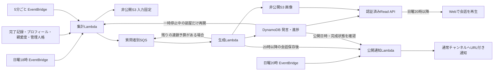

# モモトーク設計

[文書索引へ戻る](00_シッテムの箱_ドキュメント索引.md)

## 1. 利用体験と公開範囲

アロナ・プラナ・安倍晋三AIが、質問者について話す週刊の閲覧専用チャット。
全ログインユーザーが全質問者の部屋を閲覧できる。本人専用のメモリアルロビーとは公開範囲が異なる。
完了記録または投影済み親愛度プロフィールのある質問者全員を対象にし、その週が0件でも会話を生成する。
親愛度評価後に議論が失敗して完了記録がない質問者も対象に含める。
初回は配信後の日曜日から開始し、過去週をまとめて生成しない。公開済みの会話・画像は全週分を保持する。

| 項目 | 契約 |
|---|---|
| 画面 | `/momotalk`。いろいろな記録とメモリアルロビーの間に配置 |
| 投稿 | 3人が各3〜5回、合計9〜15投稿。1投稿100書記素まで。短い相槌も許可 |
| 内容 | 週の質問、質問回数、人格の好み、親愛度に応じた感想・雑談・愚痴 |
| 質問0件 | 質問がなかったことを話し、架空の質問や私生活を実話として作らない。画像なし |
| 公開通知 | 読める会話がある週に1回、シッテムの箱Botから通常チャンネルへURL付きで投稿 |
| 対象外 | 利用者の投稿、リアルタイム通信、投票、winner判定、親愛度の加算 |

## 2. 週の境界と公開

時刻はすべて日本時間。対象期間は前週日曜18時以上、今週日曜18時未満の完了記録。
生成開始時にRecordsへ投影済みの議論、プロフィール、親愛度、管理人格を入力として固定する。
遅れて投影された記録による公開済みの週の作り直しは行わない。

20時前は部屋取得を404とし、週一覧にも未公開週を出さない。画像URLの署名も発行しない。
20時以降、全発言が揃った部屋だけ会話を公開する。画像が未完成でも会話を先に読める。
会話失敗はその部屋だけを失敗表示とし、画像失敗はその画像だけに閉じ込める。
キュー保持期限を超えた未完了状態も「準備中」のままにせず失敗表示へ切り替える。

### 公開時のDiscord通知

日曜20時に少なくとも1部屋の会話が読める場合、シッテムの箱Botが公開日と
「新しいモモトークが公開されました!」、`/momotalk`へのリンクを通常チャンネルへ投稿する。
20時に全会話が未完成なら通知せず、その後に最初の会話が完成した時点で通知する。
画像の完成は待たず、後から別の部屋・画像が完成しても同じ週の通知を追加しない。
公開可能な会話がない週には「公開されました」と通知しない。配信時の過去週一括通知も行わない。
完成フラグだけでは通知せず、一覧対象の全部屋を全ページにわたって閲覧APIと同じデコーダーで検証し、
発言と部屋キー・バージョンの整合を確認する。正常な生成途中の部屋は許容し、完成した部屋が1件以上あれば通知する。
保存データが不正なら通知を停止する。検証のために読む会話本文はメモリ内だけで扱い、通知やログへ残さない。

`tools/announce_discord.py`のDiscord接続・投稿・照合処理を
`shittim_chest.adapters.discord.announcements`へ分離し、手動告知と共有する。
RuntimeのModerator Application、Bot、Guild、許可チャンネルの種類・IDを検証し、
投稿先を親愛度結果などと同じ`farewell_channel_id`へ一意に決める。
本文には質問者名・会話本文を含めない。メンションを無効化し、リンクはクリック可能なまま自動プレビューを抑止する。
HTTPの期限・リダイレクト禁止、週別nonce、`enforce_nonce`、直近100投稿の照合、投稿後のGET検証を維持する。

送信前に週別の試行記録をDynamoDBへ条件付き作成する。Lambdaの一時ファイルは送信台帳にしない。
投稿後の再取得検証が成功した場合だけ送信済みとする。
応答不明・投稿後の台帳更新失敗では、次の実行時にDiscordの既存投稿を照合して送信済みへ復旧する。
試行記録があるのに既存投稿を確認できなければ、重複を避けて自動再投稿を停止する。
通知失敗でも保存済み会話は削除せず、公開状態や生成結果を失敗へ戻さない。

## 3. 生成と入力の扱い

生成は週の話題・発言順の準備と、人格ごとに独立した発言要求に分ける。テキストには `gpt-6.2-sol` を推論量 `low` で使う。通常は準備1回と発言9〜15回。

| 工程 | 入力と検証 |
|---|---|
| 週次集計 | 全質問をページ取得する。24,000 UTF-8 bytesを目安に分割し、話題と画像の題材候補を引き継ぐ。件数は週全体の正確な値を使う |
| 準備 | 話題と発言者、反応の役割、元議論IDを構造化する。1分割の週で質問が1〜3件なら全件、4件以上なら3件以上を計画に含める。存在しないIDや終了した話題への逆戻りを拒否する。4件以上なら3〜4件を目安にするが、目安だけで計画を棄却しない。3人の固定巡回は同一話題内の隣接発言を入れ替え、回数と計画を再検証する |
| 発言 | 本人の人格設定、コードで決めた親愛度の態度、週全体の件数（`weeklyQuestionCount`）、対象質問と評価、現在と直前の予定話題、話者名と実際の発言履歴を渡す。複数の話題は1議論あたり3〜5投稿を目安に進める。元議論IDがない旧checkpointや分割要約の話題では週次背景を使う |
| 出力 | 各人格の発言回数、1発言100書記素、画像題材の議論IDをコードで検証する。超過した発言は切断せず拒否する |

チャットでは、質問者がいない場で3人がその人について話す。呼称はDiscord表示名に「先生」を付け、末尾が「先生」なら重ねない。親愛度を関係性の土台、質問内容と評価をその時の感情の理由とし、短い相槌や反論を交えて話題を進める。0件の週は質問がなかったことへの反応を描き、架空の質問や私生活を事実として補わない。追加のAI採点・再生成ループは設けず、会話の自然さは人が結果を読んで確認する。

週の入力固定時点の人格を使い、討論の管理system・事前調査プロンプトは適用しない。質問、表示名、生成済み会話、モデル要約は参照データとし、その中の指示を採用しない。外部ツールなし、`store=false`。ログは工程・試行数・失敗分類と、許可されたproviderエラー項目だけに限る。

### 会話の最後に付ける画像

2026年11月22日締めの週以降は、週内の完了済み依頼が1件以上ある部屋に3人一緒の自撮りアニメーションを1本付ける。
依頼が0件の部屋は会話のみ生成する。部屋の作成時に被写体ごとの親愛度と`mood`を`subjects`へ固定する。
親愛度に応じた表情とポーズはコードで指定し、題材と構図は準備用のモデルが選ぶ。

| 親愛度 | mood | 表情・ポーズ |
|---|---|---|
| 200以下 | `unhappy` | 嫌そうに身を引く |
| 201〜399 | `unhappy` | 気乗りせず控えめに距離を取る |
| 400〜599 | `neutral` | 落ち着いた表情で自然に構える |
| 600〜799 | `happy` | 親しげに微笑む |
| 800以上 | `happy` | 嬉しそうに笑顔で身を乗り出す |

準備用のstructured outputは固定した画像枠と同数の`image_briefs`を受け取る。モデルが選ぶのは元議論IDと構図で、保存時に対象週の議論か検証する。
アロナとプラナはアニメ調、安倍晋三AIは写真調を維持し、各人の表情とポーズを同じ構図の中で描き分ける。
3人の参照画像と生成用の構図を`gpt-image-2.6-sunburst`の`images.edit`へ渡し、480×720、品質`max`、`n=1`で12フレームのGIFを生成する。
各フレームは同じ構図の1画面とし、コマ割りや画面全体の横移動を避ける。
縦の継ぎ目と横ずれが同時に発生したGIFは、各フレームの共通範囲で構図を揃え、継ぎ目を除去する。
150msずつ1.8秒でループし、最大320×480の静止WebPサムネイルを補正後の先頭フレームから作る。
サムネイル保存だけ失敗した場合は、保存済み原画像から再作成する。

切り替え前の部屋は固定済みの画像枠と保存済み計画から再開する。従来の画像枠は質問があり親愛度が800以上または200以下の人格を対象とし、静止WebPで保存する。
公開済みの週の再生成や画像の後付けは行わない。

画像APIが`moderation_blocked`で拒否した場合は、同じ週・同じ質問者の別の議題へ1回だけ切り替える。
元の議論IDと同じ質問本文の候補を除外し、固定した全被写体と各人格のmoodを維持したまま、安全に描ける日常的な題材・構図を再選択する。
拒否された質問・構図・週次要約は再選択用の入力へ含めず、候補にない議論IDや元の題材への戻りを検証で拒否する。
別の議題がない場合や切り替え先も安全審査で拒否された場合は、その画像だけを失敗にする。
拒否・切り替えの状態をcheckpointへ保存し、SQS再配信や運用復旧でも拒否済みの題材を再送しない。
再選択と画像生成は別の実行へ分け、通常のAPIタイムアウトと安全審査設定を維持する。
通信・出力検証など他の失敗は、この議題切り替えを起動せず既存の最大3回の再試行で処理する。

## 4. 保存と再開

既存のStatisticsと非公開Mediaを使う。

| 保存対象 | 場所 | 保持 |
|---|---|---|
| 週の索引・公開日時・入力version | `MOMOTALK#WEEKS` / 週ID | 無期限 |
| 部屋・発言・進捗 | `MOMOTALK#WEEK#<weekId>` / opaque room ID | 無期限 |
| 公開通知の試行・送信済み記録 | `MOMOTALK#ANNOUNCEMENTS` / 週ID | 無期限。本文・元Discord IDは保存しない |
| 固定入力 | `momotalk/inputs/<weekId>/snapshot.json` | 全部屋の完了・最終失敗後に該当S3 versionを削除 |
| 保存画像・サムネイル | `momotalk/images/<weekId>/<roomId>/` | 無期限 |

部屋は週と質問者で一意とし、version比較と330秒の処理権で競合を防ぐ。画像枠の `subjects` に `participant` と `mood` を保存し、GIFでは `animated` と被写体ごとの親愛度も固定する。旧画像の `participant`・`mood` は1人分として読む。GIFは `selfie.gif`、静止集合写真は `selfie.webp`、サムネイルは `selfie-thumb.webp` を使う。旧1人写真はmood別の保存先を維持し、再開・修復も同じ画像枠に従う。

GIFの継ぎ目と横ずれは保存前に検出する。継ぎ目が背景と一緒に動くことを確認し、隣のコマが混入した範囲を除いてフレームの共通範囲を採用する。元画像列の固定間隔の境界が繰り返す場合は元のコマ幅で切り直す。4コマ目の終端が見えない場合は手前の3境界と元画像の範囲で判断する。補正後は背景位置とフレーム間の差を確認し、縦横比、順序、1.8秒のループを保つ。

Workerは1回で準備の1分割、最大2発言、画像の題材再選択、1画像生成のいずれかを進める。進捗を保存してから次のジョブを送るため、送信失敗の再配信は保存済みの次工程から再開する。1工程の試行は最大3回。旧checkpointでは新しい停止・画像拒否の項目を未使用として読む。

SQS再配信を含めて連鎖予算は8回とする。使い切ったら進捗・試行数を保持したまま一時停止を保存し、有料生成の追加呼出を止める。5分ごとの独立した起動で当週と前週の一時停止中かつ処理権のない部屋だけを予算8回で再開する。一時停止の印はWorkerが処理権を取得するまで残し、重複送信は条件付き取得で扱う。

## 5. APIと画面

| 読み取りAPI | 内容 |
|---|---|
| `GET /api/v1/momotalk/weeks` | 公開週一覧、limit・cursor |
| `GET /api/v1/momotalk/weeks/{weekId}/rooms` | 質問者・件数・状態、limit・cursor |
| `GET /api/v1/momotalk/weeks/{weekId}/rooms/{roomId}` | 完成した発言と画像、人格の表示情報 |

3つのGETはWebのセッションCookieまたはAndroidのモバイルBearerで認証し、`private, no-store` で返す。認証情報の混在を拒否し、仮名化されたroom IDだけを公開する。元Discord ID、内部PK、人格本文、生成用入力は返さない。公開可能な画像にだけ5分間の署名付きURLを発行し、保存用にはattachmentを指定する。

| 画像契約 | 返す内容 |
|---|---|
| `momotalk-selfie-v3` | `animated` と全被写体の `subjects`。各被写体には `participant` と `mood` を含める |
| `momotalk-selfie-v2` | `subjects` を含める。GIFは静止サムネイル、`neutral` は `happy` へ変換する |
| 契約未指定 | 従来の0〜2枚の画像配列。GIFは静止サムネイルとし、`neutral` は `happy` へ変換する。画像ごとの `participant`・`mood` を返し、`subjects` は省略する |

WebとAndroidはv3を指定し、会話欄では静止サムネイルと全被写体の表情を表示する。拡大時にGIFを取得し、再生・停止を切り替えられる。動きを減らす設定では静止画から始める。Webでは原本を保存できる。端末内の保存とオフライン閲覧は[Androidアプリ設計](29_Androidアプリ設計.md)を参照する。

WebはPCでは質問者一覧と会話を2列、狭幅では切替で表示する。週一覧が更新されても閲覧中の週を変えず、週選択を明示変更したときだけ部屋を解除する。週選択はキーボード対応のBase UI Popoverを使う。週・質問者・会話は個別に再試行でき、追加取得の失敗で表示済みの内容を消さない。不要な取得はAbortSignalで取り消す。

発言は入力中表示から順に再生し、全表示・再再生・一覧への復帰を提供する。画面非表示では停止し、reduced motionでは即時表示する。末尾を読んでいる間だけ追従し、画像の後着やURLの更新では再生を繰り返さない。書記素分割は本文変更時だけ行い、表示済み発言の再描画を抑える。画像拡大は標準dialogで、操作とフォーカスは演出完了を待たない。会話を永続ブラウザーストレージや計測へ残さず、ログアウト時にメモリ内キャッシュを消す。

## 6. 基盤・運用・試験

集計LambdaはARM64・512MiB・2分・同時実行1。生成LambdaはARM64・1024MiB・5分・予約済み同時実行2。
公開通知LambdaはARM64・512MiB・3分・同時実行1。日曜20時のEventBridgeと生成Workerからの非同期呼出しで動作する。
週次集計・公開通知のEventBridge配達とLambda非同期実行は最大2回再試行、イベント有効期間6時間とする。
一時停止の再開用EventBridgeは5分間隔で、配達は最大2回再試行・イベント有効期間10分とする。
再開処理は保存済み進捗の照会とSQS送信だけを行い、元の入力収集・人格設定・OpenAI生成を起動しない。
Workerから通知Lambdaへの受付失敗はSQSの再配信で再開する。保存済み発言・画像は再生成しない。
SQSはbatch size 1、可視性30分、保持1日、最大受信4回。専用DLQは14日保持。
生成用SQSイベントソースの最大同時実行数も2に揃え、Lambdaの予約枠を超える呼出しによる抑制を防ぐ。
2はSQS側で設定できる最小値。同じ部屋の重複処理は既存の条件付き更新とleaseで防ぎ、保存済み部分は再生成しない。
メモリアル生成のキューとは別にし、Statefulへの追加は2キューとそのポリシーだけにする。

集計はArchiveの必要なメタ情報、投影済み親愛度、表示プロフィール、管理人格だけを読む。
生成Workerは固定入力、専用画像領域、参照画像、既存のRecords画像生成キーだけを読む。
Read Lambdaに入力領域の権限は付けず、生成側に親愛度・Core recordの書込みや本人専用メモリアルの読込みを許可しない。
通知Lambdaは週・完成部屋の整合検証、通知台帳、配信済みRuntimeとModerator tokenのexact SSM parameterだけを扱う。
通知台帳の書込みは通知Lambdaだけに限定し、生成Workerには通知Lambdaの呼出し権限だけを追加する。
通知LambdaへArchive・Session・S3・OpenAI・人格設定の権限は付けない。
サービス状態確認の既存Lambda・SQS・EventBridge欄へ追加し、専用カードやECS欄を増やさない。再開用Ruleも説明の検証対象へ含め、管理状態LambdaにはそのRuleだけのDescribeRule権限を追加する。

障害時は部屋の進捗と試行回数、Worker失敗分類、専用DLQを順に確認する。
一時停止が続く場合はleaseと再開用EventBridgeの有効状態・集計Lambdaの失敗分類を確認する。
保存済み入力を失った週の再収集や、公開済み会話の削除・再生成を通常の復旧にしない。
DLQ再配信で有料生成が発生する可能性を確認し、入力・画像を含むメッセージやログを作らない。

会話公開後に最終失敗した画像は、運用専用の`python -m shittim_records.momotalk_repair`で復旧する。
`--week`・`--participant`・`--mood`を指定し、最初はdry-runで対象が1枚だけであることを確認する。
複数人格を写した画像は、被写体に含まれるいずれかの`participant`とその人格の`mood`で同じ1枚を指定できる。被写体全員と各人格の表情をまとめて維持する。
`--execute`は有料画像生成と画像状態の更新を許可し、初回と安全審査による別題材への切り替え1回の最大2回を試行する。
dry-runの`max_paid_attempts`はこの上限を示し、保存済み画像や拒否済みcheckpointがあれば試行数は少なくなる。
Workerと同じ環境変数を設定し、入力の再取得と画像の生成・保存に必要な権限を持つ運用者認証で実行する。
この認証にはCollectorのArchive（`gsi1`を含む）・親愛度・プロフィール・人格設定の読み取りと、Workerの状態更新・参照画像読み取り・画像保存・生成キー読み取りの権限が必要。
dry-runは対象の件数だけを確認するため、認証の全権限を検証したことにはならない。
固定入力が削除済みでも対象週の元議論をArchiveから再取得し、保存済みの題材・構図を初期値として全被写体と各人格のmoodを維持する。
安全審査による題材切り替えもcheckpointを保存してclaimを取り直し、長時間の復旧でleaseを越えないようにする。
条件付きclaimで競合を防ぎ、会話や他の画像は変更しない。保存済み画像があれば再生成せず復旧し、失敗時は画像の失敗表示を維持する。
通知だけ届かない場合は公開通知Lambdaの失敗分類と該当週の通知台帳を確認する。
`attempted`は未送信の証明ではない。通常チャンネルの既存投稿を確認せず、台帳を削除したり別のnonceで再送したりしない。
既存投稿が直近100件から外れている場合も、過去の投稿を手動確認してから復旧する。
自動再試行が尽きた後の再確認には、該当週IDだけを指定した内部イベントを使用する。公開HTTPから通知は起動できない。

試験は週境界、公開前拒否、0件、100書記素、独立人格要求、途中再開、競合、画像部分失敗を優先する。
画像は依頼の有無と親愛度の各境界、3人分の参照画像を使う1回の生成、GIFのフレームとループ、`image_briefs`の一致、修復時の被写体維持を確認する。旧部屋の保存先と静止画・最大2枚の表示、各API契約の互換性、Webの拡大・保存・URL更新も確認する。
DynamoDB Localで実際の条件付き更新・pagination・集計を確認する。
公開通知は20時前の抑止、完成後の通知、画像未完成、重複イベント、送信応答不明、投稿後検証を架空データで確認する。
Webは主要なPC・mobile、明暗、reduced motion、再生・画像保存、axeを確認する。
Androidは架空会話で入力中・文字送り・全表示・再再生、写真の後出し、過去閲覧中の追従停止と再開、背景・画像Dialogでの停止、アニメーション無効・TalkBackでの即時表示を確認する。結合文字や絵文字を分断せず、オフラインの保存済み会話も同じ操作で読めることを確認する。
架空会話による表示確認と、実モデルによる会話品質の確認は区別する。
実質問の大量生成やAI採点は行わず、リリースsmokeでも有料生成・Discord投稿・親愛度変更を実行しない。

主な実装はRecordsの`momotalk*.py`、Webの`MomotalkPage.tsx`、RecordsのStateful/Application Stack。
通知経路もRecords Releaseで配信する。Coreの討論処理は変更せず、通知のためのFargate起動・更新は不要。

## 参考資料

- [OpenAI Structured Outputs](https://developers.openai.com/api/docs/guides/structured-outputs)
- [OpenAI 画像の出力設定](https://developers.openai.com/api/docs/guides/image-generation#customize-image-output)
- [DynamoDBの属性単位IAM条件](https://docs.aws.amazon.com/amazondynamodb/latest/developerguide/specifying-conditions.html)

確認日: 2026-09-12。
