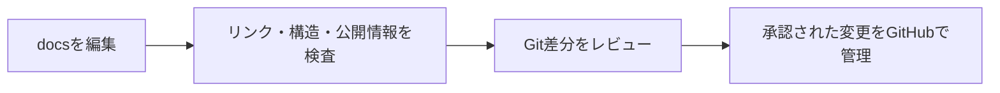

# シッテムの箱の設計文書

入口は[ドキュメント索引](00_シッテムの箱_ドキュメント索引.md)です。
利用者向けの概要から、機能別設計、運用・検証へ順に読めます。

## 正本と公開範囲

このリポジトリの`docs/`を正本とし、Gitで変更履歴を管理します。
GitHubで閲覧・レビューでき、Obsidian、Vault、CouchDBの起動や同期は不要です。
対象はシッテムの箱の公開用文書だけです。非公開Vault資料、他のプロジェクト、
認証情報、端末固有の設定は取り込みません。元のVaultとバックアップは変更しません。



## 変更する手順

1. 索引の「変更内容と編集先」から、その仕様を管理する文書を選ぶ。
2. 作業ブランチの`docs/`を編集し、必要な関連リンク・図表と更新日を直す。実際に確認していない検証日や配信状態は変えない。
3. リポジトリのルートで検査し、差分をレビューする。コードと仕様が変わる場合は同じ変更に含める。

```sh
uv run --frozen python -m tools.check_docs
uv run --frozen python tools/check_public_surface.py
git diff --check
```

旧`tools/sync_docs.py --write`はGitの正本を古いVaultで上書きしないため停止しています。
`--check --source <旧公開文書フォルダー>`は移行時の比較専用です。一致を日常の編集条件にはしません。
差分があれば実装と照合して個別に取り込み、Vault全体をコピーしないでください。

## 書き方の約束

- 本文と見出しは日本語、API名・コード上の識別子は原綴りを使う。用語は初出で説明する。
- 現行の仕様、過去の判断、配信の証拠を分ける。同じ仕様を複数の文書へ複製しない。
- 文書間は通常の相対Markdownリンクを使う。空白を含むパスは`%20`にする。
- 構成・順序・状態遷移はMermaid、比較・対応関係は表、単純な注意事項は本文か短い箇条書きにする。
- コードへのリンクはGitHub上のファイルを使い、端末固有の絶対パスを書かない。
- 新しい文書を追加する場合は、索引と文書検査の対象一覧も更新する。

対象一覧は`tools/sync_docs.py`の`EXPECTED_DOCUMENT_PATHS`に残しています。
文書・公開情報の検査で、対象外ファイル、シンボリックリンク、認証情報・個人識別情報を確認します。
文書はMITライセンスの対象外です。[文書の利用条件](LICENSE.md)を確認してください。
